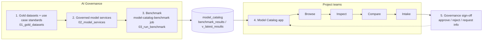

# Co-operators Model Release Lifecycle

A governed path for generative AI at Co-operators, built on Databricks. **AI Governance** sets the standard for how AI may be used: it builds gold datasets, registers candidate models as governed model services, and benchmarks them. The results are published in the **Model Catalog** app. **Project teams** then use the app to browse the catalog, compare models on their use case and submit an intake request for governance sign-off.



## The framework journey

### 1. AI Governance sets the standard: gold datasets and use case configuration

Notebook [`notebooks/01_gold_datasets.py`](notebooks/01_gold_datasets.py) defines what good looks like for each approved use case. It writes to `serverless_nv91sa_catalog.model_catalog`:

| Table | Rows | Purpose |
| --- | --- | --- |
| `gold_fraud_detection` | 150 | Masked claim call transcripts, about 30% with fraud triggers and the expected trigger ids |
| `gold_call_summarization` | 100 | Customer-service calls with 3-sentence reference summaries and 4-6 key facts |
| `gold_churn_detection` | 150 | Calls, emails and agent notes with tenure, product count and a churn label (about 25% true) |
| `use_case_config` | 3 | Per use case: system prompt (with JSON output contract), metric list, headline metrics, pass/fail thresholds, daily volume |

* All data is synthetic and generated with a fixed seed (`dataset_version = 'v1'`). PII/PCI appears only as placeholders such as `[NAME]` or `[POLICY_NO]`.
* `use_case_config` is the contract. The benchmark reads system prompts, metrics and thresholds **only** from this table; nothing is hard-coded in the job. `headline_metrics[0]` is the primary metric, and `thresholds` is a `map<metric, struct<direction: gte|lte, value>>`.
* Use cases: `fraud_detection`, `call_summarization`, `churn_detection`.

### 2. AI Governance registers the candidate models as governed model services

Notebook [`notebooks/02_model_services.py`](notebooks/02_model_services.py) creates one Unity Gateway model service per candidate model, named `mc-<model>`, in the `model_catalog` schema:

* **Candidates**, by capability tier: frontier (`mc-claude-opus-5-5`, `mc-gpt-6-1-sol`, `mc-grok-4-7`), mid (`mc-claude-sonnet-5-5`, `mc-gemini-3-8-flash`, `mc-kimi-k3-1-pro`, `mc-qwen35-122b`), lightweight (`mc-claude-haiku-5-5`, `mc-gemini-3-1-flash-lite`, `mc-gpt-oss-20b`).
* **Observability**: usage is tracked in `system.ai_gateway.usage`, and each service logs payloads to an inference table `model_catalog.mc_<model>_payload`.
* **Governance tags**: `capability_tier`, `status` (starts as `experimental`; governance owns it after that), `provider`, `hosting_type`, `data_residency`, `cost_tier`, `owner`, `licence_type`, `pii_allowed`, and `approved_use_cases` (added by the app when a request is approved).
* **Catalog table**: `refresh_model_services()` MERGEs every `mc-*` service, its tags and its prices into `model_catalog.model_services`. Services that were removed are marked `is_active = false`.
* **Pricing**: DBU rates are kept in the editable `MODEL_PRICES` dict. USD is always worked out as DBU x the current $/DBU of the provider's `ENTERPRISE_<PROVIDER>_MODEL_SERVING` SKU in `system.billing.list_prices`, and dollar values are never hard-coded. `price_source` is `list_price` or `placeholder`.

### 3. AI Governance benchmarks the models

The `model-catalog-benchmark` job ([`resources/model_catalog_benchmark.job.yml`](resources/model_catalog_benchmark.job.yml)) is run manually by governance (Jobs UI: *Run now with different parameters*). It has two tasks:

1. `refresh_model_services`: runs `02_model_services` with `run_mode=refresh`, so the catalog table matches the live services.
2. `run_benchmark`: runs [`notebooks/03_run_benchmark.py`](notebooks/03_run_benchmark.py).

| Parameter | Default | Meaning |
| --- | --- | --- |
| `model_services` | `all` | Comma-separated `mc-*` names, or `all` |
| `use_case_id` | `fraud_detection` | `fraud_detection`, `call_summarization` or `churn_detection` |
| `sample_size` | `all` | `all`, or N. N gives a fixed hash-ordered sample, so every model sees the same records |
| `judge_model` | `system.ai.claude-sonnet-4-6` | LLM judge for the MLflow scorers |

What the benchmark does:

* Calls every selected service on every gold record in parallel through the Unity Gateway, with per-service concurrency limits, retries and rate-limit handling.
* Scores outputs with MLflow GenAI evaluation, using code scorers (for example trigger precision/recall/F1, fraud/churn accuracy and F1, JSON validity) and an LLM judge (faithfulness, completeness, conciseness), plus operational metrics (latency p50/p95, error rate, average tokens, cost per 1k requests, projected monthly cost from `daily_volume`).
* Logs each run to the MLflow experiment `model-catalog/<use_case_id>`.
* Appends to `benchmark_results` (one row per run x service x metric, with a pass/fail against the thresholds) and `benchmark_examples` (per-record outputs and scores). `v_latest_results` exposes the latest run per service and use case. The task has no retries, so a partial run is never written twice.

### 4. The results are published in the Model Catalog app

[`model-catalog-app/`](model-catalog-app/) is a Databricks App (React + Vite + Tailwind frontend, FastAPI backend). Every query runs **on behalf of the signed-in user** through the SQL warehouse, so Unity Catalog permissions apply. It reads `model_services`, `use_case_config`, `v_latest_results`, `benchmark_results`, `benchmark_examples`, the `mc_*_payload` inference tables and `intake_requests`. The only table it writes to is `intake_requests`.

### 5. Project teams go from browsing the catalog to intake

The journey bar in the app follows the project team's path:

1. **Browse** (`Catalog`): every governed model service, with capability tier, provider, cost tier, status, and an "Approved for" filter. You can also choose the use case here.
2. **Inspect** (`ModelDetails`): one model's governance tags, pricing, benchmark metrics against the use case thresholds, example outputs and live usage.
3. **Compare** (`Compare`): up to several models side by side on the headline metrics, quality, latency and projected cost for the chosen use case.
4. **Intake** (`Intake`): the team describes the project (objective, input data and format, volume, latency and cost sensitivity, ground truth, regulatory considerations). The **Model Selection Advisor** Genie agent recommends a model from the benchmark evidence. The team then picks a model, proposes a risk tier (low/medium/high) and submits.
5. **Sign-off**: AI Governance (the `GOVERNANCE_USERS` in `app.yaml`) sees every request in the Requests tracker and can **Approve**, **Reject** or **Request info**, and confirms the risk tier. Approval adds the use case to the model service's `approved_use_cases` tag. Project teams see only their own requests. Notifications are in-app (a badge on the Intake tab).
6. **Deploy** (UI scaffold only): the deploy drawer shows the next step. This phase has no deployments table or deploy job.

`intake_requests` has one row per request. Its status moves `submitted` -> `approved` | `rejected` | `info_requested` -> `deployed`, and it records `decision_by` / `decided_at`. It is both the tracker source and the sign-off audit trail.

## Repository layout

```
.
├── README.md
├── databricks.yml                         # Declarative Automation Bundle (dev / prod targets)
├── resources/
│   └── model_catalog_benchmark.job.yml    # model-catalog-benchmark job definition
├── notebooks/
│   ├── 01_gold_datasets.py                # Step 1: gold datasets + use_case_config
│   ├── 02_model_services.py               # Step 2: mc-* model services + model_services table
│   └── 03_run_benchmark.py                # Step 3: benchmark + results tables
└── model-catalog-app/                     # Steps 4-5: Databricks App
    ├── app.yaml                           # Entrypoint + env (catalog, schema, warehouse, Genie space, governance users)
    ├── requirements.txt, package.json     # Python and Node dependencies
    ├── backend/                           # FastAPI: main.py, sql.py (all SQL), db.py, genie.py, tags.py
    └── src/                               # React: pages/, components/, theme.css (the only theme file)
```

## Getting started

Prerequisites: Unity Catalog access to `serverless_nv91sa_catalog.model_catalog`, serverless compute, the SQL warehouse `test_arc_1`, and Unity Gateway access to the `system.ai` models.

1. **Build the standards.** Run `notebooks/01_gold_datasets` once.
2. **Register the models.** Run `notebooks/02_model_services`. Fill in `MODEL_PRICES` when you have the DBU rates.
3. **Deploy and run the benchmark job** with the bundle:

   ```bash
   databricks bundle validate -t dev
   databricks bundle deploy   -t dev
   databricks bundle run model_catalog_benchmark -t dev \
     --params use_case_id=fraud_detection,model_services=all,sample_size=all
   ```

   Repeat for `call_summarization` and `churn_detection`.
4. **Deploy the app** from `model-catalog-app/`. It needs the user API scopes `sql` and `dashboards.genie`. Users need SELECT on the schema, MODIFY on `intake_requests`, CAN USE on the warehouse and access to the Genie agent. See [`model-catalog-app/README.md`](model-catalog-app/README.md) for local development.

## Open items

* `MODEL_PRICES` DBU rates and `context_window` are placeholders until governance fills them in. Until then, cost metrics are reported with `price_source = 'placeholder'`.
* Thresholds in `use_case_config` are placeholders, and so are the `daily_volume` figures for call summarization and churn.
* The account governed-tag policy on `owner` does not yet allow `ai-governance`. An account admin needs to add that value.
* `data_residency = 'unverified'` and `pii_allowed = 'false'` are defaults for governance to confirm.
* Deploy is a scaffold. A deployments table and a `model-catalog-deploy` job come in a later phase.
